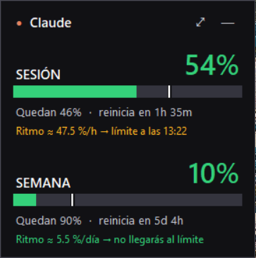
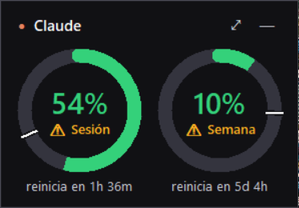
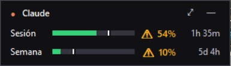

# Claude Usage

**English** · [Español](README.md)

A Windows desktop widget that shows **how much of your Claude plan you've used** (the 5-hour session and the weekly limit) and how much you have left, always in view.

> Unofficial project, not affiliated with Anthropic. The app's interface is in Spanish.

<p>
  
  
</p>


## Features

- **Real usage percentage** for each limit on your plan (5-hour session, weekly and, where applicable, Opus/Sonnet), with a countdown to the next reset.
- **Pace forecast**: estimates how fast you're using your allowance and warns you if you'll hit the limit before it resets. A white line on each bar marks how much of the window has elapsed.
- **Floating widget**: borderless and always on top, in three styles (Large, Rings, Compact) with adjustable opacity. Drag it anywhere and it remembers where you left it.
- **System tray icon** that shows the percentages in its tooltip, plus a global **Ctrl+Alt+U** shortcut to show or hide the widget.
- **Windows notifications** at 75 %, 90 % and 100 %, and when a limit resets.
- **Full window** (double-click the widget) with a 24-hour or 7-day usage chart and your Claude Code tokens by day, model and project.
- **CSV export** of the history, start with Windows, and an installer that doesn't need admin rights.

## Installation

1. Download **`ClaudeUsage-Setup.exe`** from [Releases](../../releases/latest).
2. Run it and click **Instalar** (Install). If SmartScreen appears, choose *More info → Run anyway*; it shows up because the executable isn't signed.
3. The app appears in the Start menu as **Claude Usage**.

**Requirement:** [Claude Code](https://claude.com/claude-code) installed and signed in on the PC (run `claude` once).

To uninstall: *Settings → Apps → Installed apps → Claude Usage*.

## How it works

- **Plan limits:** the app reads the OAuth token that Claude Code stores in `%USERPROFILE%\.claude\.credentials.json` and calls the same endpoint used by the `/usage` command (`api.anthropic.com/api/oauth/usage`). The token is only ever sent to Anthropic. The endpoint is undocumented and could change.
- **Tokens:** counted from Claude Code's local logs (`%USERPROFILE%\.claude\projects\**\*.jsonl`). They only cover Claude Code usage on that PC, not the claude.ai chat.
- **Local data:** history and settings are stored in the `data\` folder next to the executable.

No external dependencies: only the Python standard library (tkinter, ctypes and winreg).

## Run from source

```bash
pythonw ClaudeUsage.pyw
```

## Build the executables

Requires Python 3.10 or later. The script creates a temporary environment with PyInstaller and puts `ClaudeUsage.exe` and `ClaudeUsage-Setup.exe` in `dist\`:

```bash
powershell -ExecutionPolicy Bypass -File build.ps1
```

| File | What it is |
|---|---|
| `ClaudeUsage.pyw` | The app (widget, tray, notifications, uninstall via `--uninstall`) |
| `setup_installer.py` | The installer; supports silent install with `--silent [--dir PATH] [--no-desktop] [--no-autostart] [--no-launch]` |
| `build.ps1` | Builds both executables |
| `packaging/` | Version metadata for the `.exe` files |

## License

[MIT](LICENSE)
