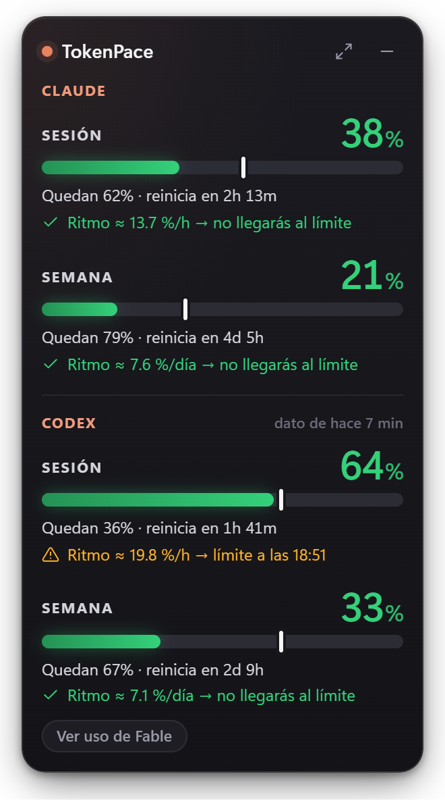
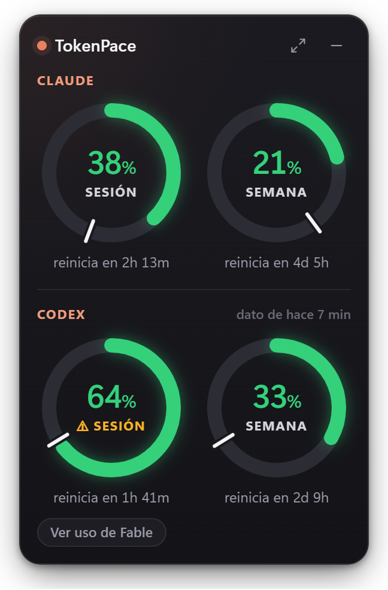
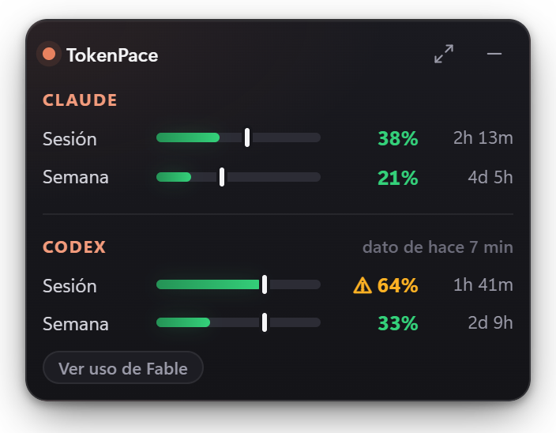
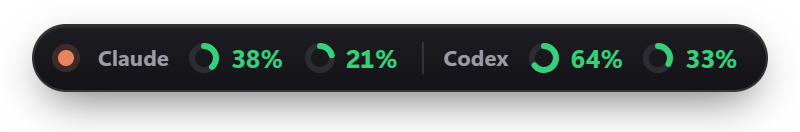
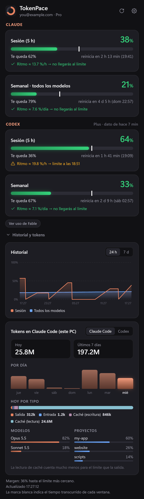

# TokenPace

[English](README.md) · **Español**

[](https://github.com/fergaschas/claude-usage-widget/releases/latest)
[](https://github.com/fergaschas/claude-usage-widget/releases)
[](LICENSE)


Widget de escritorio para Windows que muestra **cuánto has usado de tu plan de Claude** (sesión de 5 h y límite semanal), cuánto te queda y **a qué ritmo lo gastas**, siempre a la vista pero sin estorbar.

> Proyecto no oficial, sin relación con Anthropic. Hasta la versión 2.5 se llamaba *Claude Usage*.

**Versión actual: 3.1.0** · [Descargar `TokenPace-Setup.exe`](../../releases/latest/download/TokenPace-Setup.exe) · [Novedades](#historial-de-versiones)

<p>
  
  
</p>
<p>
  
  
</p>

## Funciones

- **Porcentaje de uso real** de la sesión de 5 h y del límite semanal, con cuenta atrás hasta el reinicio. Los límites secundarios (p. ej. *Fable*) quedan ocultos y se ven con el botón *Ver uso de Fable*.
- **Previsión de ritmo**: calcula a qué velocidad consumes y avisa si vas a llegar al límite antes del reinicio. Una marca blanca en cada barra o anillo indica el tiempo transcurrido de la ventana.
- **Widget que no molesta**:
  - ventana transparente con esquinas redondeadas y sombra, en tres estilos (Grande, Anillos, Compacto);
  - **se minimiza a una píldora** con los porcentajes (botón —); un clic la vuelve a abrir;
  - **se atenúa** cuando el ratón no está encima, salvo si algún límite está cerca de agotarse;
  - **se pega a los bordes** de la pantalla al soltarlo cerca, y crece hacia el lado correcto según la esquina en la que esté;
  - **se oculta solo** mientras hay una app a pantalla completa (juegos, vídeos, presentaciones).
- **Codex (OpenAI) también**: si usas [Codex](https://github.com/openai/codex), muestra sus límites de 5 h y semanal en una sección propia (y en la píldora), con avisos y previsión de ritmo, más sus tokens por día, modelo y proyecto. Se puede ocultar desde el menú (*Mostrar Codex (OpenAI)*).
- **Bandeja del sistema** con los porcentajes en el tooltip, y atajo global **Ctrl+Alt+U** para mostrar u ocultar.
- **Notificaciones de Windows** al 75 %, 90 % y 100 %, y cuando un límite se reinicia.
- **Ventana completa** (doble clic en el widget) con el gráfico interactivo del historial de 24 h o 7 días y los tokens de Claude Code: por día, por tipo, por modelo y por proyecto.
- **Exportación del historial a CSV**, arranque con Windows y un instalador que no necesita permisos de administrador.
- **Español e inglés**: usa el idioma de Windows y se puede cambiar desde el menú (*Idioma / Language*).
- **Actualizaciones desde la app** con verificación SHA-256, conservando el historial, los ajustes, los accesos directos y el inicio con Windows.



*Ventana completa (doble clic en el widget): límites de Claude y Codex con previsión de ritmo, historial de 24 h / 7 días y tokens.*

## Instalación

1. Descarga **[`TokenPace-Setup.exe`](../../releases/latest/download/TokenPace-Setup.exe)** (última versión) o elige una en [Releases](../../releases).
2. Ejecútalo y pulsa **Instalar**. Si aparece SmartScreen, elige *Más información → Ejecutar de todas formas*; sale porque el ejecutable no está firmado.
3. En el primer arranque, un asistente conecta la app con tu cuenta de Claude: comprueba que [Claude Code](https://claude.com/claude-code) está instalado (y puede instalarlo), abre el navegador para iniciar sesión en Claude y confirma que puede leer tu uso.

Requiere Windows 10 u 11 con WebView2 (incluido en Windows 11 y en Windows 10 actualizado) y una suscripción de Claude (Pro, Max, Team…), porque los límites de uso solo existen con suscripción.

**¿Tienes *Claude Usage* 2.5?** Se actualiza sola a TokenPace desde la app: se conservan la carpeta, el historial y los ajustes, y se sustituyen el acceso directo y el inicio con Windows por los de TokenPace. Con la 2.4 o anteriores, ejecuta una vez el instalador nuevo.

Para desinstalar: *Configuración → Aplicaciones → Aplicaciones instaladas → TokenPace*.

## Uso

| Acción | Resultado |
|---|---|
| Arrastrar el widget | Moverlo; al soltarlo cerca de un borde se pega a él |
| Botón **—** | Minimizar a la píldora; clic en la píldora para expandir |
| Doble clic | Ventana completa (historial y tokens) |
| Clic derecho | Menú: estilo, opacidad, atenuado, idioma, cuenta, herramientas… |
| **Ctrl+Alt+U** o clic en el icono de la bandeja | Mostrar u ocultar |

## Cómo funciona

- **Límites del plan:** la app lee el token OAuth que Claude Code guarda en `%USERPROFILE%\.claude\.credentials.json` y llama al mismo endpoint que usa el comando `/usage` (`api.anthropic.com/api/oauth/usage`). El token solo se envía a Anthropic. El endpoint no está documentado y podría cambiar.
- **Tokens:** se cuentan a partir de los registros locales de Claude Code (`%USERPROFILE%\.claude\projects\**\*.jsonl`). Solo incluyen el uso de Claude Code en ese PC, no el chat de claude.ai.
- **Codex:** Codex guarda en sus registros locales (`%USERPROFILE%\.codex\sessions\**\*.jsonl`, o `CODEX_HOME`) el estado de sus límites tras cada respuesta, y TokenPace lo lee de ahí, sin conectarse a OpenAI. Por eso el dato solo se actualiza cuando usas Codex, y se muestra cuándo es (*dato de hace 7 min*). Si una ventana ya se ha reiniciado desde entonces, se muestra a cero.
- **Datos locales:** el historial y los ajustes se guardan en la carpeta `data\` junto al ejecutable (mismo formato que la versión 2).

Está hecho con [Tauri 2](https://tauri.app): el núcleo en Rust y la interfaz en HTML/CSS/TypeScript sobre WebView2. El ejecutable ocupa unos pocos MB.

## Desarrollo

Requisitos: [Node 18+](https://nodejs.org), [Rust](https://rustup.rs) (toolchain MSVC) y Visual Studio Build Tools con C++.

```bash
npm install
npx tauri dev        # app con recarga en caliente
```

En desarrollo la app usa otro puerto de instancia única, así que se puede probar con la versión instalada abierta. Con `CLAUDE_USAGE_OFFLINE=1` no consulta a Anthropic (útil para trabajar en la interfaz sin gastar consultas).

| Ruta | Qué es |
|---|---|
| `src-tauri/src/` | Núcleo en Rust: consulta del uso e historial (`usage.rs`), tokens (`tokens.rs`), Codex (`codex.rs`), conexión con Claude Code (`connect.rs`), ventanas, bandeja y menú (`app.rs`), actualizaciones (`update.rs`), instalador (`installer.rs`) y Windows (`winsys.rs`) |
| `src/views/` | Interfaz: widget, ventana completa, asistente de conexión e instalador |
| `src/i18n.json` | Textos en español e inglés, compartidos por Rust y la interfaz |
| `build.ps1` | Compila la app y el instalador en `dist\` |
| `scripts/screenshots/` | Capturas de `docs/` con la interfaz real y datos de ejemplo: `npm run screenshots` (necesita Microsoft Edge) |

### Compilar

```bash
powershell -ExecutionPolicy Bypass -File build.ps1
```

El mismo ejecutable es la app, su instalador y su desinstalador: si su nombre contiene *setup* funciona como instalador (`TokenPace-Setup.exe --silent [--dir RUTA] [--no-desktop] [--no-autostart] [--no-launch] [--update] [--lang es|en]`), y con `--uninstall [--silent]` desinstala.

### Publicar una versión nueva

1. Sube la versión en `src-tauri/tauri.conf.json`, `src-tauri/Cargo.toml` y `package.json`.
2. Compila con `build.ps1`.
3. Crea una Release en GitHub con la etiqueta **`vX.Y.Z`** y adjunta **`dist\TokenPace-Setup.exe`** y **`dist\ClaudeUsage-Setup.exe`** (el mismo archivo; este nombre es el que buscan las instalaciones 2.x para actualizarse). GitHub publica su suma SHA-256, que la app verifica antes de instalar.

## Historial de versiones

| Versión | Cambios |
|---|---|
| **3.1.0** | **Codex (OpenAI)**: sus límites de 5 h y semanal en una sección propia del widget, de la píldora y de la ventana completa, con avisos, previsión de ritmo y sus tokens por día, modelo y proyecto. Se leen de los registros locales de Codex, sin conectarse a OpenAI. Opción *Mostrar Codex (OpenAI)* en el menú. |
| **3.0.0** | **Nuevo nombre, TokenPace, y app reescrita con Tauri** (Rust + interfaz web): ventanas transparentes con esquinas redondeadas, sombras y animaciones; anillos y gráficos suavizados; gráfico de historial interactivo; tokens por día, tipo, modelo y proyecto; menú agrupado. Widget pensado para no molestar: minimizar a píldora, atenuado en reposo, se pega a los bordes y se oculta con apps a pantalla completa. Los límites secundarios (Fable) se muestran bajo demanda. Ejecutable mucho más ligero. Se actualiza desde *Claude Usage* 2.5 conservando datos y ajustes. |
| **2.5.2** | Arreglo para PCs que se quedaban atascados en *Anthropic limita las consultas*: las esperas crecen (5, 10, 20, 30 min). Nuevo registro (*Abrir registro*). |
| **2.5.1** | Correcciones de las actualizaciones desde la app. |
| **2.5** | **Actualizaciones desde la app** con verificación SHA-256. Mejor detección de Claude Code. Botón *Copiar diagnóstico*. |
| **2.4** | **Asistente de conexión** en el primer uso. |
| **2.3** | Interfaz en **español e inglés**. |
| **2.2** | Primera versión pública. |

## Licencia

[MIT](LICENSE)
