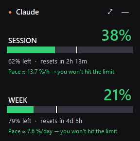
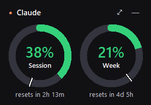
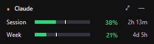

# Claude Usage

**English** · [Español](README.es.md)

[](https://github.com/fergaschas/claude-usage-widget/releases/latest)
[](https://github.com/fergaschas/claude-usage-widget/releases)
[](LICENSE)


A Windows desktop widget that shows **how much of your Claude plan you've used** (the 5-hour session and the weekly limit) and how much you have left, always in view.

> Unofficial project, not affiliated with Anthropic.

**Latest version: 2.5.2** · [Download `ClaudeUsage-Setup.exe`](../../releases/latest/download/ClaudeUsage-Setup.exe) · [What's new](#version-history)

<p>
  
  
</p>


## Features

- **Real usage percentage** for each limit on your plan (5-hour session, weekly and, where applicable, Opus/Sonnet), with a countdown to the next reset.
- **Pace forecast**: estimates how fast you're using your allowance and warns you if you'll hit the limit before it resets. A white line on each bar marks how much of the window has elapsed.
- **Floating widget**: borderless and always on top, in three styles (Large, Rings, Compact) with adjustable opacity. Drag it anywhere and it remembers where you left it.
- **System tray icon** that shows the percentages in its tooltip, plus a global **Ctrl+Alt+U** shortcut to show or hide the widget.
- **Windows notifications** at 75 %, 90 % and 100 %, and when a limit resets.
- **Full window** (double-click the widget) with a 24-hour or 7-day usage chart and your Claude Code tokens by day, model and project.
- **CSV export** of the history, start with Windows, and an installer that doesn't need admin rights.
- **English and Spanish**: follows your Windows language and can be switched at any time from the menu (*Idioma / Language*).
- **In-app updates**: the app checks GitHub for new releases and shows *Version X available · Update*. One click downloads the installer, verifies its SHA-256 checksum and restarts the app on the new version, keeping your history, settings, shortcuts and start-with-Windows choice. You can also use *Check for updates* in the menu.

## Installation

1. Download **[`ClaudeUsage-Setup.exe`](../../releases/latest/download/ClaudeUsage-Setup.exe)** (latest version) or pick one from [Releases](../../releases).
2. Run it and click **Install**. If SmartScreen appears, choose *More info → Run anyway*; it shows up because the executable isn't signed.
3. On first launch, a short wizard connects the app to your Claude account: it checks that [Claude Code](https://claude.com/claude-code) is installed (and can install it for you), opens your browser to sign in to Claude, and confirms it can read your usage. Everything updates by itself as you go.

You can reopen the wizard any time from the menu (*Claude account…*) to see which account is connected or to switch accounts. A Claude subscription (Pro, Max, Team…) is required, since usage limits only apply to subscriptions.

**Already installed?** Version 2.5 and later update themselves from inside the app. If you have 2.4 or earlier, run the new installer once: it detects your installation, offers *Update* and keeps your history and settings.

To uninstall: *Settings → Apps → Installed apps → Claude Usage*.

## How it works

- **Plan limits:** the app reads the OAuth token that Claude Code stores in `%USERPROFILE%\.claude\.credentials.json` and calls the same endpoint used by the `/usage` command (`api.anthropic.com/api/oauth/usage`). The token is only ever sent to Anthropic. The endpoint is undocumented and could change.
- **Tokens:** counted from Claude Code's local logs (`%USERPROFILE%\.claude\projects\**\*.jsonl`). They only cover Claude Code usage on that PC, not the claude.ai chat.
- **Local data:** history and settings are stored in the `data\` folder next to the executable.

No external dependencies: only the Python standard library (tkinter, ctypes and winreg).

## Run from source

```bash
pythonw ClaudeUsage.pyw
```

## Build the executables

Requires Python 3.10 or later. The script creates a temporary environment with PyInstaller and puts `ClaudeUsage.exe` and `ClaudeUsage-Setup.exe` in `dist\`:

```bash
powershell -ExecutionPolicy Bypass -File build.ps1
```

| File | What it is |
|---|---|
| `ClaudeUsage.pyw` | The app (widget, tray, notifications, uninstall via `--uninstall`) |
| `setup_installer.py` | The installer; supports silent install with `--silent [--dir PATH] [--no-desktop] [--no-autostart] [--no-launch]`, `--update` (used by the in-app updater; keeps the current shortcut and start-with-Windows choice) and `--lang es\|en` to force its language |
| `build.ps1` | Builds both executables |
| `packaging/` | Version metadata for the `.exe` files |

### Publishing a new version

The in-app updater reads the latest GitHub release, so each release must follow this format:

1. Bump the version in `APP_VERSION` (`ClaudeUsage.pyw`), `VERSION` (`setup_installer.py`) and both files in `packaging/`.
2. Build with `build.ps1`.
3. Create a GitHub release tagged **`vX.Y.Z`** (for example `v2.5.1`) and attach **`dist\ClaudeUsage-Setup.exe`** with that exact name. GitHub publishes its SHA-256 checksum, which the app verifies before installing.

## Version history

| Version | Changes |
|---|---|
| **2.5.2** | Fix for PCs that stayed stuck on *Anthropic is rate-limiting requests*: the connection wizard no longer re-queries every 10 seconds, waits grow (5, 10, 20, 30 min) and nothing skips them except the refresh button. The widget shows the retry time. New log file (*Open log* in the menu), also included in *Copy diagnostics*. |
| **2.5.1** | Fixes for in-app updates: `v2.5` and `v2.5.0` count as the same version, and the app no longer gets stuck on *Installing the update…* if the installer fails to start. |
| **2.5** | **In-app updates** with SHA-256 verification. Better Claude Code detection: the copy bundled with the Claude desktop app, nvm, scoop, bun, volta, WSL and `CLAUDE_CONFIG_DIR`. New *Copy diagnostics* button. |
| **2.4** | **Connection wizard** on first run: installs Claude Code if needed, signs you in to Claude and checks your usage. *Not connected to Claude · Connect* notice in the widget. |
| **2.3** | **English and Spanish** interface, switchable from the menu. |
| **2.2** | First public release. |

## Links

- **Website:** [latest release](https://github.com/fergaschas/claude-usage-widget/releases/latest), with the installer and what's new.
- **Topics:** [claude](https://github.com/topics/claude) · [claude-code](https://github.com/topics/claude-code) · [anthropic](https://github.com/topics/anthropic) · [windows](https://github.com/topics/windows) · [widget](https://github.com/topics/widget) · [desktop-widget](https://github.com/topics/desktop-widget) · [usage-tracker](https://github.com/topics/usage-tracker) · [rate-limits](https://github.com/topics/rate-limits) · [system-tray](https://github.com/topics/system-tray) · [python](https://github.com/topics/python) · [tkinter](https://github.com/topics/tkinter)

## License

[MIT](LICENSE)
