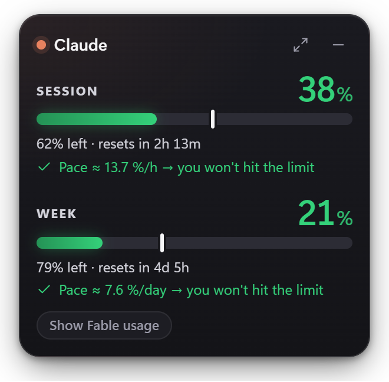
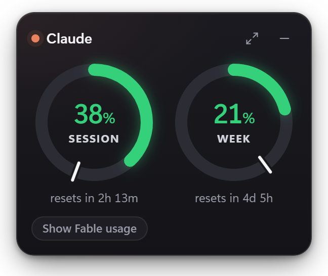
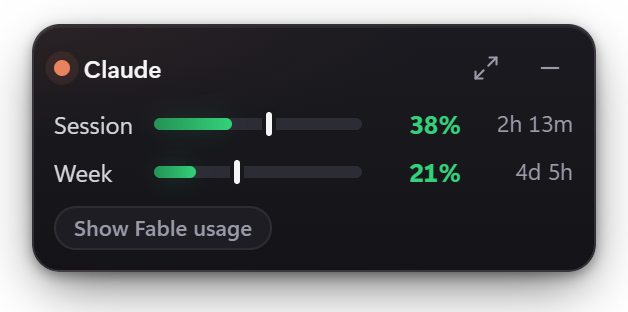
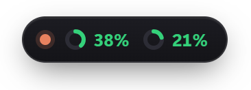
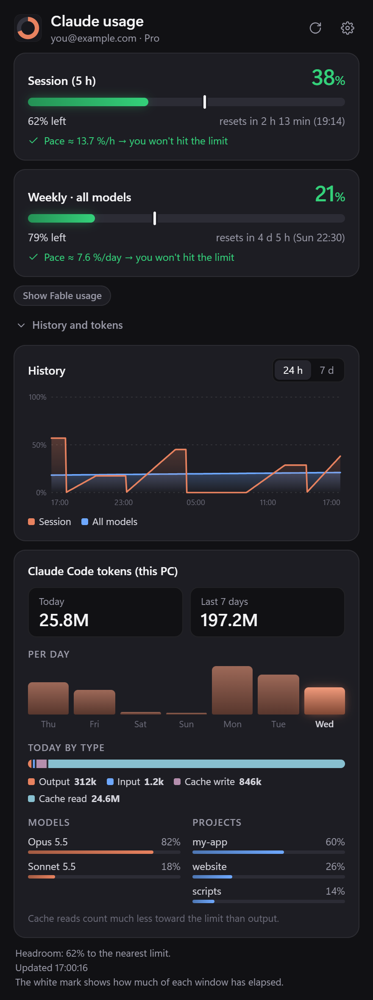

# TokenPace

**English** · [Español](README.es.md)

[](https://github.com/fergaschas/claude-usage-widget/releases/latest)
[](https://github.com/fergaschas/claude-usage-widget/releases)
[](LICENSE)


A Windows desktop widget that shows **how much of your Claude plan you've used** (the 5-hour session and the weekly limit), how much you have left and **how fast you're burning through it**: always in view, never in the way.

> Unofficial project, not affiliated with Anthropic. Up to version 2.5 it was called *Claude Usage*.

**Latest version: 3.1.0** · [Download `TokenPace-Setup.exe`](../../releases/latest/download/TokenPace-Setup.exe) · [What's new](#version-history)

<p>
  
  
</p>
<p>
  
  
</p>

## Features

- **Real usage percentage** for the 5-hour session and the weekly limit, with a countdown to the next reset. Secondary limits (such as *Fable*) stay hidden until you click *Show Fable usage*.
- **Pace forecast**: estimates how fast you're using your allowance and warns you if you'll hit the limit before it resets. A white mark on each bar or ring shows how much of the window has elapsed.
- **A widget that stays out of the way**:
  - transparent window with rounded corners and a soft shadow, in three styles (Large, Rings, Compact);
  - **collapses to a pill** with the percentages (— button); click the pill to expand it again;
  - **dims** when the mouse isn't over it, unless a limit is about to run out;
  - **snaps to screen edges** when you drop it near one, and grows towards the right side depending on the corner it sits in;
  - **hides itself** while a full-screen app is running (games, videos, presentations).
- **Codex (OpenAI) too**: if you use [Codex](https://github.com/openai/codex), its 5-hour and weekly limits get their own section (and a spot in the pill), with alerts and pace forecast, plus its tokens by day, model and project. Hide it from the menu (*Show Codex (OpenAI)*).
- **System tray icon** that shows the percentages in its tooltip, plus a global **Ctrl+Alt+U** shortcut to show or hide it.
- **Windows notifications** at 75 %, 90 % and 100 %, and when a limit resets.
- **Full window** (double-click the widget) with an interactive 24-hour / 7-day history chart and your Claude Code tokens by day, type, model and project.
- **CSV export** of the history, start with Windows, and an installer that doesn't need admin rights.
- **English and Spanish**: follows your Windows language and can be switched from the menu (*Idioma / Language*).
- **In-app updates** with SHA-256 verification, keeping your history, settings, shortcuts and start-with-Windows choice.



*Full window (double-click the widget): limits with pace forecast, 24-hour / 7-day history and Claude Code tokens.*

## Installation

1. Download **[`TokenPace-Setup.exe`](../../releases/latest/download/TokenPace-Setup.exe)** (latest version) or pick one from [Releases](../../releases).
2. Run it and click **Install**. If SmartScreen appears, choose *More info → Run anyway*; it shows up because the executable isn't signed.
3. On first launch, a short wizard connects the app to your Claude account: it checks that [Claude Code](https://claude.com/claude-code) is installed (and can install it for you), opens your browser to sign in to Claude, and confirms it can read your usage.

Requires Windows 10 or 11 with WebView2 (built into Windows 11 and up-to-date Windows 10) and a Claude subscription (Pro, Max, Team…), since usage limits only apply to subscriptions.

**Have *Claude Usage* 2.5?** It updates itself to TokenPace from inside the app: your folder, history and settings are kept, and the shortcut and start-with-Windows entry are replaced with TokenPace's. With 2.4 or earlier, run the new installer once.

To uninstall: *Settings → Apps → Installed apps → TokenPace*.

## Usage

| Action | Result |
|---|---|
| Drag the widget | Move it; drop it near an edge to snap to it |
| **—** button | Collapse to the pill; click the pill to expand |
| Double-click | Full window (history and tokens) |
| Right-click | Menu: style, opacity, dimming, language, account, tools… |
| **Ctrl+Alt+U** or click the tray icon | Show or hide |

## How it works

- **Plan limits:** the app reads the OAuth token that Claude Code stores in `%USERPROFILE%\.claude\.credentials.json` and calls the same endpoint used by the `/usage` command (`api.anthropic.com/api/oauth/usage`). The token is only ever sent to Anthropic. The endpoint is undocumented and could change.
- **Tokens:** counted from Claude Code's local logs (`%USERPROFILE%\.claude\projects\**\*.jsonl`). They only cover Claude Code usage on that PC, not the claude.ai chat.
- **Codex:** Codex writes the state of its limits to its local logs after every response (`%USERPROFILE%\.codex\sessions\**\*.jsonl`, or `CODEX_HOME`), and TokenPace reads them from there without contacting OpenAI. That's why the data only updates when you use Codex, and the app shows how old it is (*data from 7 min ago*). If a window has reset since then, it shows as zero.
- **Local data:** history and settings are stored in the `data\` folder next to the executable (same format as version 2).

It's built with [Tauri 2](https://tauri.app): a Rust core and an HTML/CSS/TypeScript interface on WebView2. The executable is just a few MB.

## Development

Requires [Node 18+](https://nodejs.org), [Rust](https://rustup.rs) (MSVC toolchain) and Visual Studio Build Tools with C++.

```bash
npm install
npx tauri dev        # app with hot reload
```

In development the app uses a different single-instance port, so you can test it while the installed version is running. With `CLAUDE_USAGE_OFFLINE=1` it doesn't query Anthropic (handy for UI work without spending requests).

| Path | What it is |
|---|---|
| `src-tauri/src/` | Rust core: usage and history (`usage.rs`), tokens (`tokens.rs`), Codex (`codex.rs`), Claude Code connection (`connect.rs`), windows, tray and menu (`app.rs`), updates (`update.rs`), installer (`installer.rs`) and Windows integration (`winsys.rs`) |
| `src/views/` | Interface: widget, full window, connection wizard and installer |
| `src/i18n.json` | English and Spanish strings, shared by Rust and the interface |
| `build.ps1` | Builds the app and installer into `dist\` |
| `scripts/screenshots/` | The `docs/` screenshots, rendered from the real interface with sample data: `npm run screenshots` (needs Microsoft Edge) |

### Build

```bash
powershell -ExecutionPolicy Bypass -File build.ps1
```

The same executable is the app, its installer and its uninstaller: when its name contains *setup* it acts as the installer (`TokenPace-Setup.exe --silent [--dir PATH] [--no-desktop] [--no-autostart] [--no-launch] [--update] [--lang es|en]`), and `--uninstall [--silent]` uninstalls it.

### Publishing a new version

1. Bump the version in `src-tauri/tauri.conf.json`, `src-tauri/Cargo.toml` and `package.json`.
2. Build with `build.ps1`.
3. Create a GitHub release tagged **`vX.Y.Z`** and attach **`dist\TokenPace-Setup.exe`** and **`dist\ClaudeUsage-Setup.exe`** (the same file; 2.x installations look for this name to update themselves). GitHub publishes their SHA-256 checksum, which the app verifies before installing.

## Version history

| Version | Changes |
|---|---|
| **3.1.0** | **Codex (OpenAI)**: its 5-hour and weekly limits get their own section in the widget, the pill and the full window, with alerts, pace forecast and its tokens by day, model and project. Read from Codex's local logs, without contacting OpenAI. *Show Codex (OpenAI)* option in the menu. |
| **3.0.0** | **New name, TokenPace, and a rewrite on Tauri** (Rust + web UI): transparent windows with rounded corners, shadows and animations; smooth rings and charts; interactive history chart; tokens by day, type, model and project; grouped menu. A widget designed to stay out of the way: collapse to a pill, dim when idle, snap to edges and hide during full-screen apps. Secondary limits (Fable) are shown on demand. Much smaller executable. Updates from *Claude Usage* 2.5 keeping your data and settings. |
| **2.5.2** | Fix for PCs stuck on *Anthropic is rate-limiting requests*: waits grow (5, 10, 20, 30 min). New log file (*Open log*). |
| **2.5.1** | Fixes for in-app updates. |
| **2.5** | **In-app updates** with SHA-256 verification. Better Claude Code detection. *Copy diagnostics* button. |
| **2.4** | **Connection wizard** on first run. |
| **2.3** | **English and Spanish** interface. |
| **2.2** | First public release. |

## License

[MIT](LICENSE)
